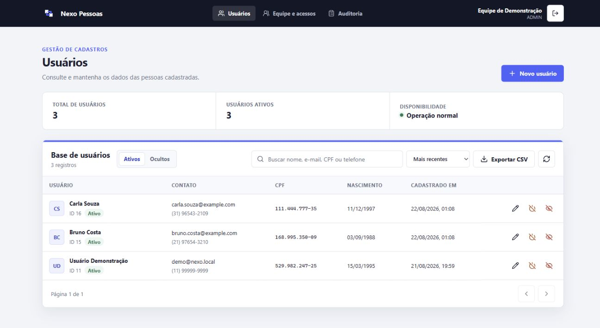
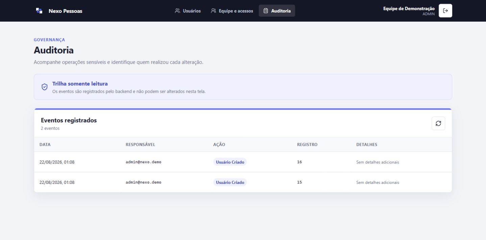
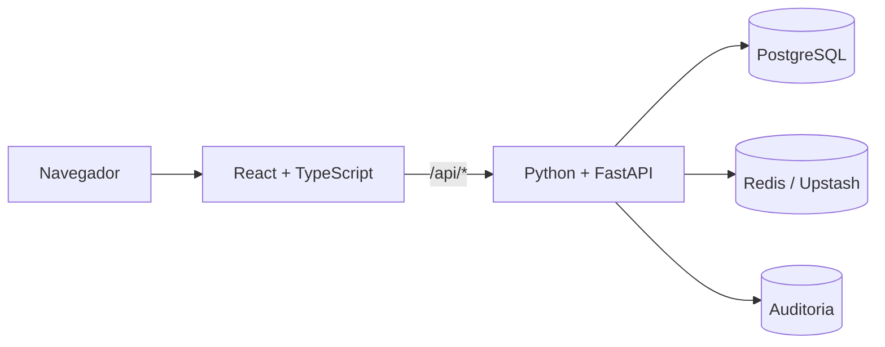

# Nexo Pessoas

[](https://github.com/LuKeTempestt/nexo-pessoas/actions/workflows/ci.yml)
[](https://github.com/LuKeTempestt/nexo-pessoas/actions/workflows/codeql.yml)
[](https://nexo-pessoas.vercel.app)
[](https://github.com/LuKeTempestt/nexo-pessoas/releases)
[](./LICENSE)

**Plataforma full stack para gestão segura do ciclo de vida de usuários.** O
produto combina React e TypeScript com uma API Python/FastAPI, PostgreSQL,
Redis, Docker e automação de qualidade no GitHub.

[Aplicação online](https://nexo-pessoas.vercel.app) ·
[API interativa](https://nexo-pessoas.vercel.app/api/docs) ·
[Última versão](https://github.com/LuKeTempestt/nexo-pessoas/releases/latest)

> A instância pública é uma demonstração técnica e não oferece credenciais
> compartilhadas. Use somente dados fictícios. A imagem abaixo também contém
> cadastros sintéticos, criados exclusivamente para apresentação.





## Como avaliar em três minutos

1. Veja a interface responsiva e o fluxo CRUD na captura acima.
2. Consulte os contratos, validações e códigos HTTP no
   [Swagger/OpenAPI](https://nexo-pessoas.vercel.app/api/docs).
3. Revise a [arquitetura](./docs/ARQUITETURA.md), os
   [controles de segurança](./SECURITY.md) e as execuções de
   [CI e CodeQL](https://github.com/LuKeTempestt/nexo-pessoas/actions).

O repositório mantém frontend, backend, banco e Redis separados sem esconder a
integração entre eles. O smoke test do Docker percorre o CRUD real contra
PostgreSQL e valida autenticação, auditoria e rate limiting.

## Problema e solução

Cadastros de pessoas costumam misturar dados pessoais, contas de acesso e ações
administrativas numa única camada. Isso dificulta controle de permissão,
rastreabilidade e exclusão segura. O Nexo Pessoas separa essas responsabilidades
e oferece um fluxo operacional único para equipes pequenas.

### Funcionalidades

- criação, consulta, busca, paginação e edição de usuários;
- ativação e desativação sem perda do cadastro;
- exclusão lógica, restauração e exclusão permanente em duas etapas;
- perfis `ADMIN`, `OPERADOR` e `AUDITOR` com permissões no backend;
- criação visual do primeiro administrador, sem senha padrão no código;
- gestão de contas, perfis, senhas e sessões da equipe;
- trilha de auditoria paginada com área própria para administradores e auditores;
- exportação da página atual em CSV;
- validação no React, na API e em constraints do PostgreSQL;
- sessão em cookie `HttpOnly`, proteção CSRF, hash `scrypt` e rate limiting;
- healthchecks, contêineres sem privilégios e pipeline de segurança.

## Decisões técnicas

| Decisão | Motivo |
|---|---|
| Pessoas e contas de acesso são entidades diferentes | Um cadastro não recebe permissão administrativa por acidente |
| Ocultar vem antes de apagar definitivamente | A operação comum é reversível; a destrutiva exige intenção explícita |
| RBAC é validado na API | Esconder botões melhora a experiência, mas não é controle de segurança |
| Redis guarda apenas contadores temporários | PostgreSQL continua sendo a fonte dos dados do produto |
| Frontend e backend são serviços distintos | Cada camada pode evoluir e ser testada sem virar dois produtos desconectados |
| Configuração de produção falha cedo | A API não inicia sem banco, rate limit compartilhado, cookie seguro e setup protegido |

## Arquitetura



| Camada | Pasta | Responsabilidade |
|---|---|---|
| Frontend | `frontend/` | Interface, formulários, cache e feedback ao usuário |
| Backend | `backend/` | API REST, autenticação, autorização e casos de uso |
| Banco | `database/` | Schema, constraints, índices e migrações SQL |
| Redis | serviço de infraestrutura | Limite compartilhado de tentativas de acesso |

Na Vercel, React e FastAPI são serviços independentes do mesmo projeto. O mesmo
domínio entrega a interface em `/` e a API Python em `/api/*`.

## Executar com Docker

Pré-requisito: [Docker Desktop](https://www.docker.com/products/docker-desktop/).

```powershell
git clone https://github.com/LuKeTempestt/nexo-pessoas.git
cd nexo-pessoas
docker compose up --build -d
```

Abra [http://localhost:3000](http://localhost:3000). No primeiro acesso, escolha
o nome, o e-mail e a senha do administrador. Não há login universal escondido
no repositório.

```powershell
docker compose ps
docker compose down
```

`docker compose down` preserva o banco. O acréscimo de `-v` remove o volume e
apaga os dados locais.

### Serviços locais

| Serviço | Endereço | Uso |
|---|---|---|
| `frontend` | `http://localhost:3000` | Produto completo via Nginx |
| `backend` | `http://localhost:8000` | API FastAPI e Swagger |
| `database` | `localhost:5433` | PostgreSQL persistente |
| `redis` | `localhost:6379` | Contadores temporários de segurança |
| `migrate` | execução única | Aplica os scripts SQL e encerra |

## Desenvolvimento

Pré-requisitos: Node.js 22+, Python 3.12+, [uv](https://docs.astral.sh/uv/) e
Docker Desktop.

```powershell
npm install
uv sync --project backend
Copy-Item backend/.env.example backend/.env
npm run dev:infra
npm run dev
```

No Linux ou macOS, substitua `Copy-Item` por
`cp backend/.env.example backend/.env`. O React abre em
`http://localhost:5173`; o FastAPI, em `http://localhost:8000`.

## Tecnologias

| Área | Tecnologias principais |
|---|---|
| Frontend | React 19, TypeScript, Vite, TanStack Query, React Hook Form, Zod |
| Backend | Python 3.12, FastAPI, Pydantic, SQLAlchemy assíncrono, asyncpg |
| Dados | PostgreSQL 17/18, Redis 8, Neon e Upstash |
| Qualidade | Pytest, Ruff, BasedPyright, Vitest, Testing Library, ESLint, CodeQL |
| Operação | Docker Compose, Nginx, GitHub Actions, Vercel Services |

## Qualidade

```powershell
npm run lint
npm run typecheck
npm test
npm run build
```

O pipeline Linux repete essas verificações e executa um ambiente Docker real. O
smoke test cria o administrador, autentica, cadastra, edita, desativa, ativa,
oculta, restaura, exclui definitivamente e consulta a auditoria.

Na versão 5.1.0, a suíte possui 38 testes automatizados: 19 no backend e 19 no
frontend.

## Deploy gratuito de portfólio

A configuração publicada usa somente planos gratuitos:

- Vercel Hobby para os serviços React e FastAPI;
- Neon Free, PostgreSQL na região de São Paulo;
- Upstash Free integrado à Vercel para Redis REST.

Variáveis e segredos ficam nos provedores, nunca no Git. Veja o guia
[Vercel + Neon + Upstash](./docs/DEPLOY.md). Limites e regras dos planos podem
mudar; confirme os painéis antes de replicar a infraestrutura.

## Segurança e privacidade

CPF, telefone e data de nascimento são dados pessoais. A demonstração aceita
somente informações fictícias e o repositório não declara conformidade LGPD
pronta para operação comercial. Política de retenção, base legal, criptografia
de campos e atendimento ao titular dependem do contexto real de implantação.

Os controles implementados e o canal privado de vulnerabilidades estão em
[SECURITY.md](./SECURITY.md). Limitações conhecidas e próximos reforços estão no
[roadmap técnico](./docs/ROADMAP.md).

## Documentação

- [Arquitetura e decisões](./docs/ARQUITETURA.md)
- [Guia de desenvolvimento](./GUIA_PASSO_A_PASSO.md)
- [Estudo do sistema visual](./DESIGN.md)
- [Deploy pelo painel](./docs/DEPLOY.md)
- [Política de segurança](./SECURITY.md)
- [Roadmap técnico](./docs/ROADMAP.md)
- [Histórico de versões](./CHANGELOG.md)

## Estrutura

```text
nexo-pessoas/
├── backend/                 # FastAPI, domínio, serviços, repositórios e testes
├── frontend/                # React, componentes, validação e testes
├── database/                # schema e migrações PostgreSQL
├── docs/                    # arquitetura, deploy, roadmap e capturas
├── .github/                 # CI, CodeQL, Dependabot e templates
├── compose.yaml             # ambiente local completo
└── vercel.json              # frontend e backend no mesmo projeto Vercel
```

## Contribuição e licença

Leia [CONTRIBUTING.md](./CONTRIBUTING.md) antes de abrir uma mudança. O código é
distribuído sob a [licença MIT](./LICENSE).

Mantido por [João Lopes (LuKeTempestt)](https://github.com/LuKeTempestt).
