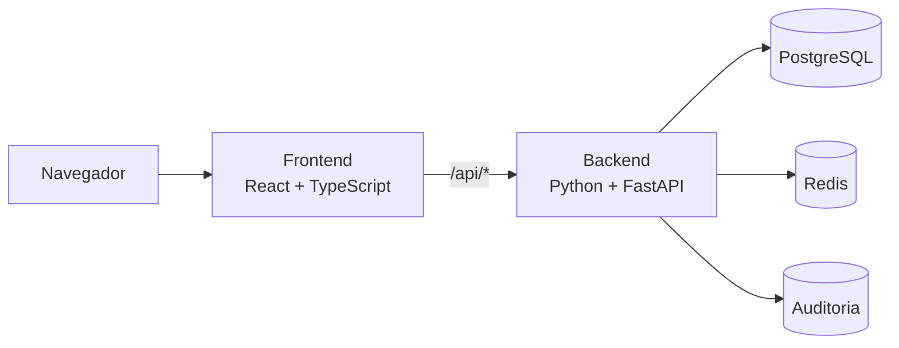

# Nexo Pessoas

[](https://github.com/LuKeTempestt/nexo-pessoas/actions/workflows/ci.yml)
[](https://github.com/LuKeTempestt/nexo-pessoas/releases)

Gestão de pessoas com controle de acesso, ciclo de vida completo e trilha de
auditoria. O Nexo Pessoas combina uma interface React responsiva com uma API
FastAPI, PostgreSQL e Redis em uma arquitetura pronta para Docker e para um
deploy único na Vercel.

## O que o produto entrega

- Cadastro, consulta, edição e busca paginada de pessoas.
- Ativação e desativação sem perda do cadastro.
- Exclusão lógica, restauração e exclusão permanente em duas etapas.
- Perfis `ADMIN`, `OPERADOR` e `AUDITOR` com permissões distintas.
- Criação visual do primeiro administrador, sem senha padrão no repositório.
- Sessão em cookie `HttpOnly`, proteção CSRF e senha com `scrypt`.
- Gestão de contas, troca de perfil, redefinição de senha e revogação de sessões.
- Auditoria das alterações e exportação de resultados em CSV.
- Validação no React, na API e no PostgreSQL.
- Healthchecks, contêineres sem privilégios e pipeline de qualidade no GitHub.

## Arquitetura



As camadas são separadas no código, no Docker e no deploy:

| Parte | Pasta | Responsabilidade |
|---|---|---|
| Frontend | `frontend/` | Interface, formulários e experiência do usuário |
| Backend | `backend/` | API, autenticação, permissões e regras de negócio |
| Banco | `database/` | Tabelas, constraints, índices e migrações SQL |
| Redis | serviço externo | Limite compartilhado de tentativas de acesso |

Na Vercel, frontend e backend são serviços independentes do mesmo projeto. O
mesmo domínio entrega React em `/` e executa Python/FastAPI em `/api/*`.

## Executar com Docker

Pré-requisito: [Docker Desktop](https://www.docker.com/products/docker-desktop/).

```powershell
docker compose up --build -d
```

Abra [http://localhost:3000](http://localhost:3000). No primeiro acesso, a tela
solicita os dados do administrador. Você escolhe o login e a senha; não existem
credenciais universais escondidas no código.

Para conferir os serviços e encerrar:

```powershell
docker compose ps
docker compose down
```

`docker compose down` preserva o banco. O acréscimo de `-v` remove o volume e
apaga os dados locais.

### Serviços locais

| Serviço | Endereço | Uso |
|---|---|---|
| `frontend` | `http://localhost:3000` | Produto completo via Nginx |
| `backend` | `http://localhost:8000` | API FastAPI e documentação técnica |
| `database` | `localhost:5433` | PostgreSQL persistente |
| `redis` | somente na rede Docker | Proteção temporária de acesso |
| `migrate` | execução única | Aplica os scripts SQL e encerra |

Swagger: [http://localhost:8000/api/docs](http://localhost:8000/api/docs).

## Desenvolvimento

Pré-requisitos: Node.js 22+, Python 3.12+, [uv](https://docs.astral.sh/uv/) e
Docker Desktop.

```powershell
npm install
uv sync --project backend
Copy-Item backend/.env.example backend/.env
docker compose up -d database redis
npm run dev
```

- React/Vite: `http://localhost:5173`
- FastAPI: `http://localhost:8000`

O Vite encaminha `/api` para o FastAPI. Variáveis locais ficam em
`backend/.env`; use `backend/.env.example` como referência e nunca versione
segredos.

## Tecnologias

| Camada | Tecnologias principais |
|---|---|
| Frontend | React 19, TypeScript, Vite, TanStack Query, React Hook Form, Zod |
| Backend | Python, FastAPI, Pydantic, SQLAlchemy assíncrono, asyncpg |
| Dados | PostgreSQL 17, Redis 8, Neon e Upstash no deploy |
| Qualidade | Pytest, Ruff, BasedPyright, Vitest, Testing Library, GitHub Actions |
| Operação | Docker Compose, Nginx, Vercel Services |

## Qualidade

```powershell
npm run lint
npm run typecheck
npm test
npm run build
```

O pipeline repete essas verificações no Linux e executa um smoke test dos quatro
serviços Docker. O fluxo ponta a ponta cobre autenticação, criação, edição,
ativação, desativação, ocultação, restauração e exclusão definitiva.

## Deploy sem custo obrigatório

O desenho recomendado usa os planos gratuitos para um projeto pessoal de
portfólio:

- Vercel: frontend React e backend FastAPI no mesmo projeto;
- Neon: PostgreSQL com URL pooled para a API;
- Upstash: Redis REST adequado ao ambiente serverless.

Nenhuma conta ou recurso externo é criado automaticamente. O guia pelo painel,
as variáveis e a ordem segura de publicação estão em
[Deploy Vercel + Neon + Upstash](./docs/DEPLOY.md).

## Documentação

- [Arquitetura e decisões](./docs/ARQUITETURA.md)
- [Guia de estudo passo a passo](./GUIA_PASSO_A_PASSO.md)
- [Deploy pelo painel](./docs/DEPLOY.md)
- [Política de segurança](./SECURITY.md)
- [Histórico de versões](./CHANGELOG.md)

## Estrutura

```text
nexo-pessoas/
├── backend/                 # FastAPI, domínio, serviços, repositórios e testes
├── frontend/                # React, componentes, validação e testes
├── database/                # schema e migrações PostgreSQL
├── docs/                    # arquitetura e publicação
├── .github/workflows/       # integração contínua
├── compose.yaml             # ambiente local em quatro serviços
└── vercel.json              # dois serviços no mesmo projeto Vercel
```
