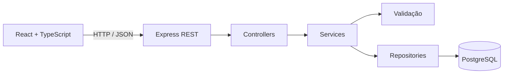

# Nexo Pessoas

Produto full stack para gerenciamento de usuários. A aplicação oferece uma
interface React responsiva, API REST em camadas e persistência PostgreSQL com
validações de integridade.

## Funcionalidades

- Cadastro, consulta, edição e exclusão lógica de usuários.
- Busca por nome, e-mail, CPF, telefone ou ID.
- Ordenação por data ou nome e paginação no cliente.
- Exportação dos resultados filtrados em CSV.
- Métricas reais de total e cadastros realizados no dia.
- Máscaras brasileiras de CPF e telefone.
- Validação compartilhada no formulário com Zod e validação independente na API.
- Estados de carregamento, erro, vazio e ausência de resultados.
- Área de usuários ocultos com restauração do cadastro.
- Ativação e desativação sem retirar o usuário da lista principal.
- Confirmação para ocultação, mensagens de retorno e navegação por teclado.
- Layout responsivo em tabela no desktop e cartões no celular.

## Tecnologias

### Front-end

- React 19 e TypeScript.
- Vite 7 para desenvolvimento e build.
- TanStack Query para cache e sincronização com a API.
- React Hook Form e Zod para formulários tipados.
- Lucide React para ícones.
- Vitest e Testing Library para testes.

### Back-end e banco

- Node.js 22 e Express 5.
- PostgreSQL 17 e driver `pg`.
- Docker Compose para o banco local.
- `node:test` e Supertest para testes de unidade e integração.

## Arquitetura



A interface não contém explicações acadêmicas. O estudo do código está no
[Guia passo a passo](./GUIA_PASSO_A_PASSO.md), e as decisões estruturais estão
em [Arquitetura](./docs/ARQUITETURA.md).

## Estrutura

```text
crud-usuarios/
├── backend/
│   ├── src/
│   │   ├── config/          # Conexão com PostgreSQL
│   │   ├── controllers/     # Entrada e saída HTTP
│   │   ├── errors/          # Erros conhecidos
│   │   ├── middlewares/     # Tratamento central de erros
│   │   ├── repositories/    # Consultas SQL
│   │   ├── routes/          # Rotas REST
│   │   ├── services/        # Regras de negócio
│   │   └── validation/      # Normalização e validação
│   └── test/
├── database/                # Criação e migrações SQL reversíveis
├── docs/                    # Documentação técnica
├── frontend/
│   ├── src/
│   │   ├── components/      # Componentes React
│   │   ├── lib/             # API, validação e utilitários
│   │   ├── test/            # Configuração de testes
│   │   ├── types/           # Tipos do domínio
│   │   ├── App.tsx
│   │   └── main.tsx
│   └── vite.config.ts
├── compose.yaml
├── DESIGN.md
└── package.json
```

## Como executar em desenvolvimento

### Pré-requisitos

- Node.js 22 ou superior.
- Docker Desktop.
- Git.

### 1. Prepare o projeto

Na raiz:

```powershell
npm install
Copy-Item backend/.env.example backend/.env
```

Se o npm apresentar `UNABLE_TO_VERIFY_LEAF_SIGNATURE`, use os certificados
confiáveis do Windows sem desativar a verificação TLS:

```powershell
$env:NODE_OPTIONS='--use-system-ca'
npm install
```

### 2. Inicie o banco

```powershell
docker compose up -d database
```

O PostgreSQL é publicado na porta `5433` para evitar conflito com instalações
locais que usam `5432`.

### 3. Inicie front-end e API

```powershell
npm run dev
```

- Interface Vite: `http://localhost:5173`
- API Express: `http://localhost:3000`

O Vite encaminha chamadas `/api` para o Express durante o desenvolvimento.

## Como executar o build de produção

```powershell
npm run build
npm start
```

Abra `http://localhost:3000`. Nesse modo, o Express entrega os arquivos
otimizados gerados em `frontend/dist`.

## Qualidade

```powershell
npm run typecheck
npm test
npm run build
```

Os comandos verificam tipos, regras de negócio, rotas HTTP, validadores,
formatadores, busca, ordenação e build de produção.

## Rotas da API

| Método | Rota | Sucesso | Descrição |
|---|---|---:|---|
| `GET` | `/api/saude` | `200` | Verifica a API |
| `GET` | `/api/usuarios` | `200` | Lista usuários |
| `GET` | `/api/usuarios/ocultos` | `200` | Lista usuários ocultos |
| `GET` | `/api/usuarios/:id` | `200` | Consulta por ID |
| `POST` | `/api/usuarios` | `201` | Cadastra usuário |
| `PUT` | `/api/usuarios/:id` | `200` | Atualiza usuário |
| `DELETE` | `/api/usuarios/:id` | `204` | Oculta usuário sem apagar |
| `PATCH` | `/api/usuarios/:id/restaurar` | `200` | Restaura usuário oculto |
| `PATCH` | `/api/usuarios/:id/desativar` | `200` | Desativa usuário visível |
| `PATCH` | `/api/usuarios/:id/ativar` | `200` | Reativa usuário desativado |

Exemplo de corpo:

```json
{
  "nome": "Maria da Silva",
  "email": "maria@exemplo.com",
  "cpf": "52998224725",
  "telefone": "11999999999",
  "dataNascimento": "1995-03-15"
}
```

## Regras de negócio

- Nome entre 3 e 120 caracteres.
- E-mail válido com até 254 caracteres.
- CPF válido e único.
- Telefone brasileiro com DDD.
- Data de nascimento existente e não futura.
- E-mail normalizado e único.
- Exclusão é lógica: `data_exclusao` recebe a data da operação.
- Usuários ocultos não aparecem nas consultas normais e podem ser restaurados.
- Usuários desativados permanecem visíveis e podem ser reativados.
- Status e data de desativação obedecem a uma restrição de consistência no banco.

## Segurança e integridade

- Consultas SQL parametrizadas.
- Credenciais fora do Git.
- Restrições `PRIMARY KEY`, `NOT NULL`, `UNIQUE` e `CHECK`.
- Índices parciais separam consultas de usuários ativos e ocultos.
- A exclusão lógica preserva histórico, identidade e possibilidade de restauração.
- Mensagens internas não são expostas ao navegador.
- React escapa conteúdo textual renderizado por padrão.
- A API não confia apenas na validação do front-end.

## Repositório

O Git local está inicializado. Depois de publicar, substitua esta linha pelo link
do seu repositório GitHub.

## Autor

Preencha com seu nome antes da entrega.
